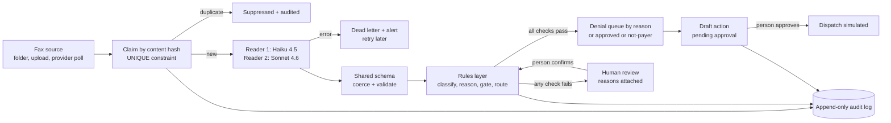

# Fax denial routing

Incoming payer faxes in, routed work out. This reads a faxed insurance letter, decides whether it is an approval, a full denial, a partial denial, or not a payer letter at all, pulls out the numbers that matter, and sends denials to the right work queue by reason. Anything the checks cannot vouch for goes to a person with the reasons attached. Nothing is sent anywhere until a person approves it.

**Status: a pilot on synthetic data.** Every payer, member and number in this repo is invented. It has never touched a real patient or a real clinic.

**Live dashboard:** https://fax-denial-routing.pages.dev/ (mirror: https://belowthestack.github.io/fax-denial-routing/; pre-computed from a real pass over the 10 synthetic letters, labeled "Synthetic data" on every screen)

## What it does

- **Intake from any source.** A folder, an HTTP upload, or a fax provider poll all go through the same `ingest` call.
- **Idempotent by content.** The fax is hashed and claimed in the database before any model is called. The same fax three times is one record and one model call.
- **Reads the page with two models.** Claude Haiku 4.5 reads the image, Claude Sonnet 4.6 reads it independently. Both are served by AWS Bedrock. They must agree on every identifier, number and date, or the fax goes to review.
- **Rules decide, not the model.** A deterministic rules layer classifies the letter and routes it. Every decision lists the rule IDs that fired (33 rules, catalogued in `faxrouting/rules.py`).
- **Routes denials by reason:** missing documentation, medical necessity, eligibility, expired authorization, coding. Partial denials keep their approved units visible.
- **A person approves every outbound action.** Drafts are created as `pending_approval`. The dispatch function refuses anything not approved. Sending is simulated in this repo.
- **Failures never lose a fax.** Model outage, unreadable scan or a bug after extraction: the fax is kept, a dead letter row is written, an alert fires, and a retry reprocesses the stored copy.
- **Append-only audit log with no medical values.** Only rule IDs, queue names, field names and event types are ever written.

## How it fits together



## What happened in the recorded pass

These are the real outputs from calling Bedrock once per reader per letter on the 10 fixtures (20 calls, about 3,960 input tokens each). They are saved in `fixtures/bedrock_captured/` and the test suite replays them, so the numbers below are reproducible without an AWS account.

| Letter | Result | Routed to |
|---|---|---|
| 01 approved assessment | Approved | Approved, filed |
| 02 approved, blurred scan | Approved (units unreadable) | **Human review** |
| 03 denial, medical necessity | Full denial | Medical necessity |
| 04 denial, missing documentation | Full denial, 30-day appeal window | Missing documentation, high priority |
| 05 denial, eligibility | Full denial (readers disagree on member ID) | **Human review** |
| 06 denial, expired authorization | Full denial | Expired authorization |
| 07 denial, coding (skewed scan) | Full denial (readers disagree on member ID) | **Human review** |
| 08 partial, fewer units | Partial denial | Medical necessity |
| 09 partial, shorter dates | Partial denial, 30-day appeal window | Missing documentation, high priority |
| 10 vendor flyer | Not a payer letter | Filed, no action |

After a person confirms the three review items, they route to approved/filed, eligibility and coding.

### The finding worth knowing about

**A model's self-reported confidence did not catch its own mistakes.** On 99 identifier, number and date fields across the 9 payer letters:

- Haiku 4.5 got 94 right. It misread two member IDs while reporting confidence 0.99 and 0.95: it dropped a digit on letter 05 and read an 8 as a 6 on the skewed scan, letter 07.
- Sonnet 4.6 got 96 right and misread nothing. Its 3 misses are the same blurred fields on letter 02 that Haiku missed, and both models reported them as unreadable (null, low confidence) rather than guessing.

Confidence alone would have let both Haiku errors through. Two independent readers that must agree is what caught them. That is why the pipeline compares readers instead of trusting one score. This is a small sample (9 letters, 2 models, one try each at temperature 0), so treat it as an observation, not a benchmark.

## Try it

Tested on Python 3.12.

```bash
pip install -r requirements.txt
python -m pytest
```

The suite holds 64 tests with no network and no AWS account. It replays the captured Bedrock payloads.

```bash
# the API, replaying the captured model outputs (no AWS needed)
FAX_BACKEND=replay uvicorn faxrouting.api:app_factory --factory

# the API against real Bedrock (needs credentials and model access in us-east-1)
FAX_BACKEND=bedrock uvicorn faxrouting.api:app_factory --factory

# upload a synthetic fax
curl -F "file=@fixtures/letters/03_denial_medical_necessity.pdf" http://127.0.0.1:8000/api/intake
```

```bash
# regenerate the fixtures, re-capture model outputs, rebuild the dashboard data
python fixtures/make_fixtures.py
python scripts/capture_bedrock.py --model us.anthropic.claude-haiku-4-5-20251001-v1:0 --label haiku-4-5
python scripts/capture_bedrock.py --model us.anthropic.claude-sonnet-4-6 --label sonnet-4-6
python scripts/export_demo.py
python -m http.server 8765 --directory dashboard
```

### What the tests check

- Each of the 10 letters is classified and routed as expected, and any document that skips review has every field exactly right.
- The same fax three times is one record, and the model is called once. Eight simultaneous arrivals of one fax also make one record.
- The audit log never contains a value read from a document, after exercising review, approval and dispatch end to end. Unlisted keys and free text are rejected, and the table refuses edits and deletes.
- A model outage dead-letters the fax and alerts, a failing alert does not hide the dead letter, and a retry processes the same fax once.
- Nothing can be dispatched without a named approver.
- Every rule that can fire is documented, and every intake path builds fields through the one shared schema.

## Design decisions

**1. Rules on top of AI.** The model is good at reading a page and bad at being accountable. So it only proposes. Fixed rules decide the document type, the denial reason and the queue, and each decision lists the rule that fired. The same extraction always gives the same decision, and a reviewer can read why. Where the model's label and the numbers disagree, that is itself a rule (`C-CONFLICT-01`) and the document goes to a person.

**2. Idempotency before the AI call.** Fax providers and polling loops redeliver. The fax is hashed and inserted under a UNIQUE constraint first. A duplicate returns the existing record without spending a model call, and the database enforces it even when two requests race.

**3. The audit log holds no medical values.** An audit trail gets copied, exported and shown to auditors, so it should not be a second copy of the data. The writer accepts only a short list of keys and short machine tokens, and the table has triggers that reject updates and deletes. A test scans the log for every value ever read from a document.

**4. One shared schema.** `faxrouting/schema.py` is the only place that defines the fields, the enums, the coercion and the validation. The Bedrock tool schema is derived from it, every extractor builds fields through it, and a human correction in the review queue is validated by the same function. A new intake path cannot drift out of step.

**5. Two readers and a person.** A single model's confidence is not a reliable error detector (see the finding above). Two readers must agree on the fields where one wrong digit changes the outcome, and a person confirms anything that fails, before any outbound action is even drafted.

## Honest limits

- **Synthetic data only.** Nothing here has been tried on real faxes. Real payer letters vary far more than 10 generated ones, and the reason keyword rules are an example of the approach, not a validated rule set.
- **No PHI belongs in this setup as it stands.** Faxage, the fax provider the original build used, does not sign a BAA, and its trial for this build has also expired, so `FaxageSource` is an untested placeholder with only its response parser covered by a test. Production needs a BAA-covered fax provider behind the same `FaxSource` interface. I am not claiming HIPAA compliance, and nothing here establishes it.
- **Bedrock coverage is an account matter.** Using Bedrock for PHI needs a signed BAA with AWS and a review of how the account is configured. That has not been done for this repo.
- **The live dashboard is not a live system.** It is a static page. The decisions in it were computed by the Python pipeline and recorded, and its buttons replay the recorded result. It cannot take an upload.
- **The API has a single shared bearer token and no user accounts.** Per-user authentication, rate limits and request signing for the fax-provider webhook would be required before real use.
- **SQLite and a single process.** Fine for a pilot. A real deployment wants Postgres, backups and a job queue.
- **Small evaluation.** The model comparison is 9 letters and one try per model.
- **Sending is simulated.** There is no fax, email or portal sender.

## n8n

`n8n/` holds two exported workflows (credentials and IDs stripped, URLs are `YOUR-...` placeholders): a 5-minute fax poll that posts each PDF to the idempotent `/api/intake/raw` endpoint, and a dead-letter alert that relays the service's alert to team chat. They validate in n8n, but they have not been tested end to end against a live fax provider, because the trial the poll was written against expired.

## Layout

```
faxrouting/schema.py      shared fields, enums, coercion, validation
faxrouting/rules.py       deterministic rules and the rule catalogue
faxrouting/extractors.py  Bedrock vision, replay, local text, two-reader consensus
faxrouting/pipeline.py    claim, extract, decide, persist, review, approvals, dead letters
faxrouting/store.py       SQLite schema, UNIQUE keys, append-only triggers
faxrouting/audit.py       whitelisted audit writer
faxrouting/api.py         FastAPI service
faxrouting/sources.py     folder source and the Faxage placeholder
fixtures/                 10 synthetic letters, ground truth, captured Bedrock payloads
dashboard/                static dashboard (data/demo.json comes from scripts/export_demo.py)
tests/                    pytest suite
n8n/                      sanitized workflow exports
```

Built by Arfa McClain. MIT licensed.
